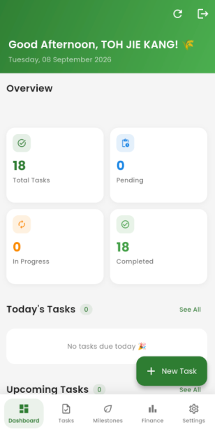
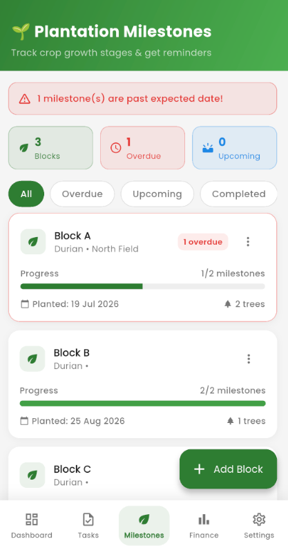
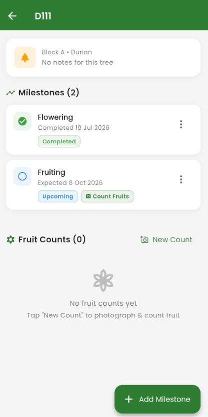
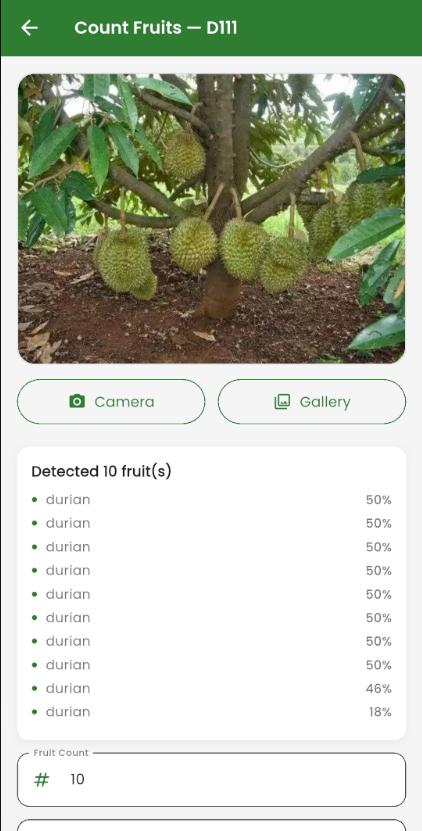
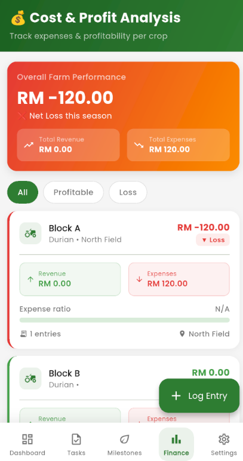
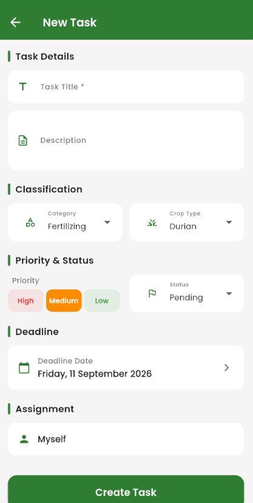

# Farm Management System

A cross-platform mobile app (Flutter) that helps Malaysian smallholder farmers growing perennial crops such as durian, oil palm, and cocoa track their costs, crop growth stages, and daily farm tasks. It includes an **on-device AI feature that counts durian fruit from a single photo**, with no internet connection needed for the detection itself.

Built as my Final Year Project for the Bachelor of Computer Science (Honours) at Universiti Tunku Abdul Rahman (UTAR), 2026.

## Screenshots

| Dashboard | Plantation milestones | Tree detail |
|:---:|:---:|:---:|
|  |  |  |

| AI fruit counting | Cost & profit analysis | New task |
|:---:|:---:|:---:|
|  |  |  |

## The problem

Smallholder farmers in Malaysia face three connected problems:
- **Finance:** costs like fertiliser and labour are rarely tracked against harvest income, so it's hard to know which crops are profitable.
- **Monitoring:** growth stages are checked manually, so important windows around flowering and fruiting are often missed. Yield is estimated by counting fruit by eye, tree by tree.
- **Scheduling:** time-critical work like spraying, pruning, and harvesting depends on handwritten notes or memory.

Existing farm management software (e.g. BushelFarm, AgriApp, Trimble Ag, CropIn) is built for large, mechanised, seasonal-crop farms, is expensive, and assumes reliable internet, which rural areas often don't have.

## Features

### 1. Task Management (offline-first)
- Create, assign, and track farm tasks with deadlines and reminder notifications
- Task templates for repeated work
- Works fully offline using local storage (Hive), and syncs with Firebase Firestore when a connection is available

### 2. Plantation Milestones (Block → Tree → Milestone)
- Organise the farm into **blocks**, each with **trees**, each with growth **milestones** (flowering, fruiting, harvesting, etc.)
- Milestone status (e.g. on track or overdue) is computed live from the current date and the expected date

### 3. AI Fruit Counting
- Take or choose a photo of a durian tree, and the app counts the visible fruit **on the device**
- The count can be adjusted manually before saving, and is stored with the photo against that tree's milestone

### 4. Cost Analysis
- Record expenses and revenue per block
- See profit or loss for each block, with a category breakdown (e.g. fertiliser vs labour) and transaction history

### Roles
- **Owner:** creates a farm and gets a farm code; manages workers and task templates
- **Worker:** joins a farm with the farm code; creates tasks assigned to themselves and adds cost entries

## How the AI fruit counting works

| | |
|---|---|
| Model | YOLOv8n (nano) object detection, trained with Ultralytics in Google Colab |
| Dataset | "Durian Project" from Roboflow Universe (~1.4k images of durian in natural, cluttered tree scenes) |
| Mobile format | TensorFlow Lite, input size 320, int8 quantisation (~3.3 MB) |
| On-device inference | `ultralytics_yolo` Flutter plugin (Android/iOS) |
| Validation score | mAP50 = 0.960, mAP50-95 = 0.713 |
| Inference time | ~4.2 ms per image (Colab validation run) |

**Tuning for clustered fruit:** durians hang in tight, overlapping clusters. The confidence threshold was lowered to 0.15 so partly hidden fruit isn't filtered out, and the IoU threshold for non-maximum suppression was raised to 0.6 so separate but overlapping fruit aren't merged into one detection.

**Lesson learned: a high score on the wrong data.** The first dataset tried gave a near-perfect validation score (mAP50 = 0.995), but on real tree photos it detected only **one fruit per photo**, no matter how many were visible. Inspecting the dataset showed why: every image was a single durian on a plain background, so the model had learned to find one durian per image, not to count fruit in a real scene. Retraining on the second dataset, with many labelled fruit per photo in natural tree scenes, fixed it. Both test photos (6 and 8 fruit) were then counted correctly.

See [ML_TRAINING_GUIDE.md](ML_TRAINING_GUIDE.md) for the training and export steps.

## Tech stack

| Layer | Technology |
|---|---|
| App | Flutter, Dart |
| Cloud backend | Firebase Authentication, Cloud Firestore, Firebase Storage |
| Offline storage | Hive |
| Notifications | flutter_local_notifications |
| On-device ML | ultralytics_yolo (TensorFlow Lite) |
| Model training | Python, Ultralytics YOLOv8, Roboflow, Google Colab |

## Project structure

```
lib/
├── main.dart
├── models/        # Data models (block, tree, milestone, task, fruit count, finance entry, user, worker)
├── screens/       # UI: auth, dashboard, tasks, milestones, fruit counting, cost analysis, settings
├── services/      # Firebase, Hive (offline storage), notifications, fruit detection
├── utils/         # Constants and app colours
└── widgets/       # Reusable UI components
assets/models/     # fruit_detector.tflite (the trained model)
```

## Getting started

### Prerequisites
- Flutter SDK (developed with Flutter 3.41)
- Android Studio with an Android emulator or a physical Android device
- A Firebase project

> The fruit counting feature uses a plugin that only runs on Android/iOS, so it won't work on the web/Chrome target. The rest of the UI can be previewed there.

### Setup
1. Clone the repo and install packages:
   ```bash
   git clone https://github.com/JasonToh9672/farm-management-system.git
   cd farm-management-system
   flutter pub get
   ```
2. Create a Firebase project and enable **Authentication** (email/password), **Cloud Firestore**, and **Storage**.
3. Connect the app to your Firebase project with the [FlutterFire CLI](https://firebase.google.com/docs/flutter/setup):
   ```bash
   flutterfire configure
   ```
   This generates `lib/firebase_options.dart` and `android/app/google-services.json`. These files are not included in this repo.
4. Publish Firestore and Storage security rules in the Firebase console. The default rules deny all access, so the app can't read or write data until rules are published.
5. Run the app on an Android emulator or device:
   ```bash
   flutter run
   ```
   On Windows, Flutter's Android build needs **Developer Mode** enabled. As a workaround, `run.bat` builds the debug APK with Gradle and installs it with `adb` (update the `adb` path inside it for your machine).

## Testing

- **Use case testing:** 5 core use cases (register and join a farm, manage tasks, manage blocks/trees/milestones, count fruit, add cost entries) all passed.
- **Targeted tests for suspected weak points:** 3 additional tests were designed to probe likely failure cases, and they surfaced the known limitations below.
- **Model testing:** validation metrics in Colab, plus a manual spot check on real cluster photos (2 photos, both counted correctly). This is a small check, not a full accuracy study.

## Known limitations

- **Offline support is partial:** only Task Management is fully offline-first. Saving a fruit count needs the photo to upload to Firebase Storage first, so it fails when offline. (The detection itself runs offline.)
- **Role permissions are enforced only in the app's UI:** the database rules check farm membership but not role, so a worker who bypassed the UI could perform owner-only actions.
- **Deleting a tree doesn't delete its fruit-count records** or their photos in Storage.
- **Tested on an Android emulator only;** iOS has not been tested.
- **Fruit counting accuracy** was checked on only two photos.

## Future work

- Extend the offline-first design to the milestone and cost analysis modules, and add an upload queue so fruit counts can be saved offline
- Enforce roles in the Firestore and Storage security rules, not only in the UI
- Delete fruit-count records and photos when a tree is deleted
- Train models for oil palm and cocoa using the same method
- Evaluate accuracy on many more trees, lighting conditions, and phone cameras
- Try a float16 model export instead of int8, to see if confidence scores become more spread out

## Acknowledgements

- Supervisor: Ts Tan Teik Boon, Faculty of Information and Communication Technology, UTAR
- Training data: "Durian Project" dataset on [Roboflow Universe](https://universe.roboflow.com/) (see the dataset page for its licence)
- Object detection: [Ultralytics YOLOv8](https://docs.ultralytics.com/) and the `ultralytics_yolo` Flutter plugin
